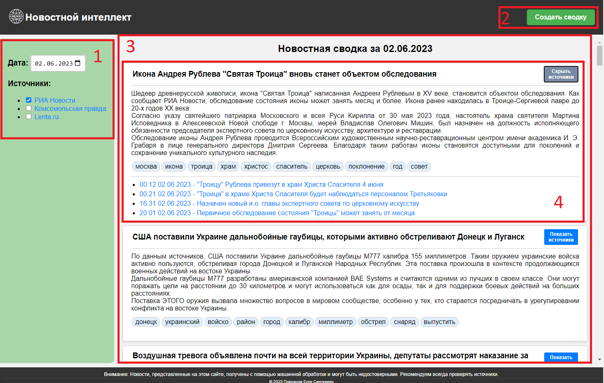

# news_intelligence

[](https://www.python.org/)
[](https://fastapi.tiangolo.com/)
[](LICENSE)

[Русский](#русский) | [English](#english)



## Русский

`news_intelligence` - учебно-экспериментальное веб-приложение для сбора, кластеризации и краткого обобщения новостей. Проект объединяет парсинг новостного сайта, NLP-предобработку, кластеризацию текстов и генерацию новостных блоков через ChatGPT API.

### О проекте

Приложение помогает получить компактную сводку новостей за выбранную дату и по выбранным источникам. Если готовая сводка уже сохранена в базе данных, она отображается сразу; если данных нет, приложение собирает новости, группирует похожие материалы по темам, выделяет ключевые слова и формирует краткий текстовый блок.

Проект создавался как учебная работа, поэтому он не позиционируется как production-ready сервис. Его практическая ценность - в демонстрации полного пайплайна: от сбора данных до веб-интерфейса и сохранения результата.

### Возможности

- выбор даты и источников новостей через веб-интерфейс;
- парсинг новостей РИА Новости за период или по расписанию;
- сохранение новостей, источников и кластеров в PostgreSQL;
- предобработка русскоязычных текстов: токенизация, стоп-слова, лемматизация;
- кластеризация новостей по похожести текстов с помощью TF-IDF и HDBSCAN;
- выделение ключевых слов для каждого кластера;
- генерация заголовка и краткого новостного блока через ChatGPT API;
- отображение сводок и ссылок на исходные новости в HTML-шаблонах.

### Стек

- Python
- FastAPI
- Jinja2
- SQLAlchemy
- Alembic
- PostgreSQL
- BeautifulSoup
- Selenium
- NLTK
- pymorphy2
- scikit-learn
- HDBSCAN
- Sumy
- OpenAI API

### Быстрый старт

```powershell
git clone https://github.com/EgorPlehanov/news_intelligence.git
cd news_intelligence

py -3.10 -m venv .venv
.\.venv\Scripts\Activate.ps1

python -m pip install --upgrade pip
pip install -r requirements.txt
```

Создайте файл `.env` на основе примера:

```powershell
Copy-Item .env.example .env
```

После копирования укажите в `.env` параметры PostgreSQL и `OPENAI_API_KEY`.

Примените миграции и запустите приложение:

```powershell
alembic upgrade head
uvicorn app.main:app --reload
```

После запуска откройте:

```text
http://127.0.0.1:8000
```

> Важно: для работы проекта нужен доступный PostgreSQL, ключ OpenAI API и установленный браузер/драйвер для Selenium.

### Документация

- [Описание проекта и архитектуры](docs/project-overview.md)
- [Запуск и разработка](docs/development.md)

### Статус

Проект находится в учебно-экспериментальном состоянии. Основной сценарий реализован, но перед использованием как публичного сервиса нужны доработка конфигурации, тесты, обработка ошибок, обновление зависимостей и более надежная работа с внешними источниками.

### License

Проект распространяется по лицензии [MIT](LICENSE).

## English

`news_intelligence` is an educational and experimental web application for collecting, clustering, and summarizing news. It combines news parsing, NLP preprocessing, text clustering, and ChatGPT-based digest generation.

### About

The application creates a compact news digest for a selected date and set of sources. If a digest has already been saved in the database, it is returned immediately; otherwise, the project collects articles, groups related news by topic, extracts keywords, and generates a short readable news block.

This is not a production-ready service. The project demonstrates an end-to-end data pipeline: collection, storage, processing, summarization, and presentation in a web UI.

### Features

- date and source selection through a web interface;
- scheduled and period-based RIA Novosti parsing;
- PostgreSQL storage for news, sources, and clusters;
- Russian text preprocessing with tokenization, stop-word filtering, and lemmatization;
- TF-IDF and HDBSCAN-based news clustering;
- keyword extraction for each cluster;
- title and digest generation via ChatGPT API;
- HTML output with source links for each digest card.

### Tech Stack

- Python
- FastAPI
- Jinja2
- SQLAlchemy
- Alembic
- PostgreSQL
- BeautifulSoup
- Selenium
- NLTK
- pymorphy2
- scikit-learn
- HDBSCAN
- Sumy
- OpenAI API

### Quick Start

```powershell
git clone https://github.com/EgorPlehanov/news_intelligence.git
cd news_intelligence

py -3.10 -m venv .venv
.\.venv\Scripts\Activate.ps1

python -m pip install --upgrade pip
pip install -r requirements.txt
```

Create a `.env` file from the example:

```powershell
Copy-Item .env.example .env
```

Then update `.env` with your PostgreSQL settings and `OPENAI_API_KEY`.

Apply migrations and run the application:

```powershell
alembic upgrade head
uvicorn app.main:app --reload
```

Open:

```text
http://127.0.0.1:8000
```

> Note: the project requires PostgreSQL, an OpenAI API key, and a browser/driver setup for Selenium.

### Documentation

- [Project overview and architecture](docs/project-overview.md)
- [Setup and development](docs/development.md)

### Status

This is an educational and experimental prototype. The main workflow is implemented, but production use would require stronger configuration management, tests, error handling, dependency updates, and more robust external-source parsing.

### License

This project is licensed under the [MIT License](LICENSE).
