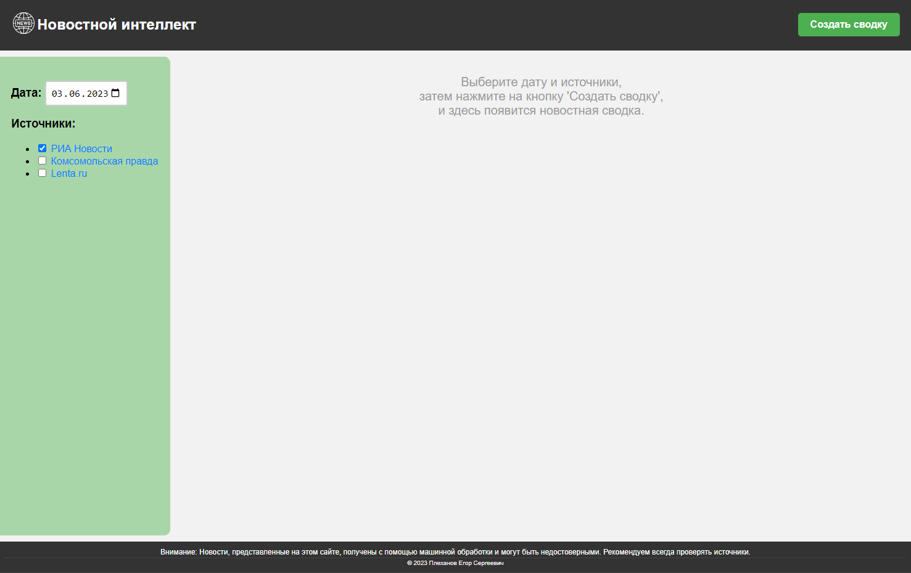
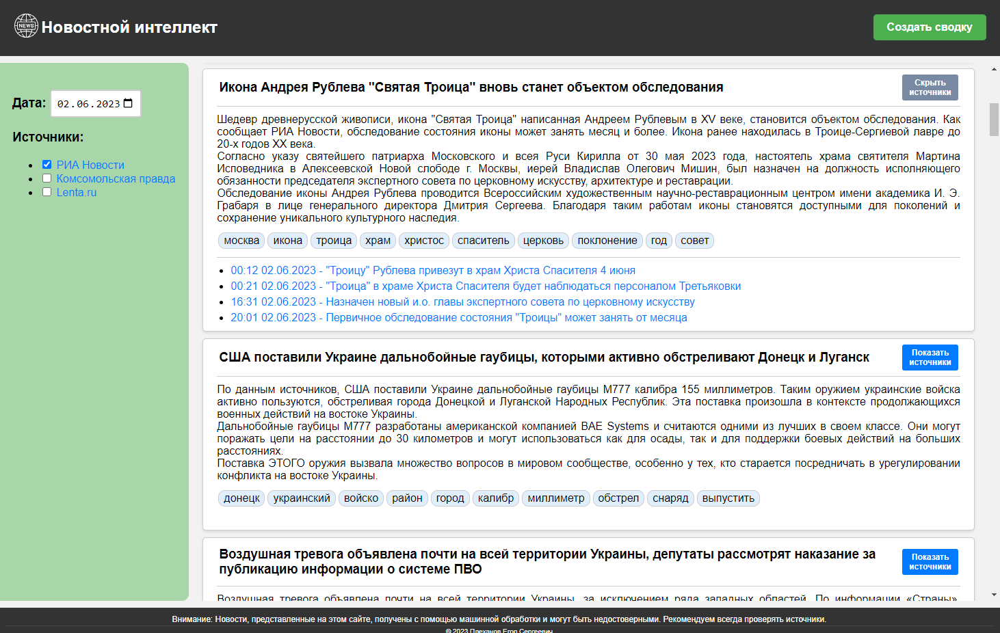
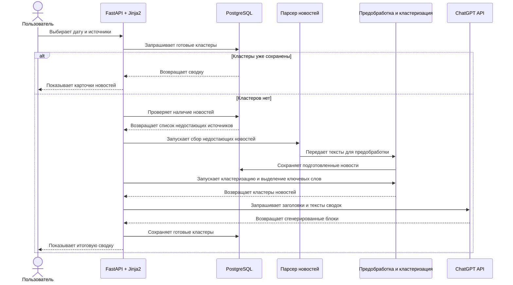
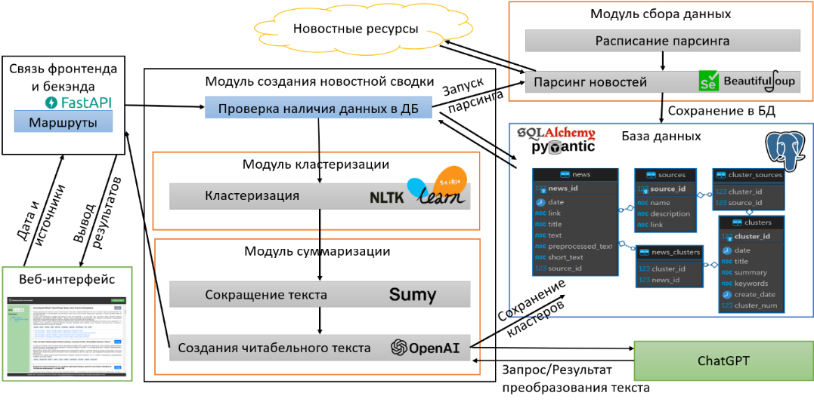

# Описание проекта

`news_intelligence` - приложение для автоматизированного сбора и обобщения новостей. Его основная идея - превратить набор отдельных публикаций за выбранный день в компактную сводку по темам.

Проект показывает полный цикл обработки новостных данных: получение материалов из внешнего источника, сохранение в базе данных, текстовую предобработку, кластеризацию похожих новостей, выделение ключевых слов и генерацию читаемых новостных блоков.

## Какую задачу решает проект

При ручном чтении новостей пользователь часто сталкивается с повторяющимися публикациями об одном и том же событии. Приложение решает эту задачу за счет группировки похожих новостей и создания краткой сводки по каждой группе.

В текущей реализации проект ориентирован на демонстрацию подхода, а не на промышленную эксплуатацию. Основной источник парсинга - РИА Новости. Архитектура при этом предполагает возможность добавлять другие источники через отдельные парсеры.

## Основной пользовательский сценарий

1. Пользователь открывает главную страницу приложения.
2. Выбирает дату и один или несколько источников новостей.
3. Нажимает кнопку создания сводки.
4. Приложение проверяет, есть ли готовые кластеры в базе данных.
5. Если готовой сводки нет, приложение собирает недостающие новости, кластеризует их и генерирует текст.
6. Пользователь получает список карточек: заголовок, краткая сводка, ключевые слова и ссылки на исходные материалы.

## Workflow

## Устройство приложения

## Основные модули

- `app/main.py` - точка входа FastAPI-приложения, маршруты главной страницы и создания сводки.
- `app/config.py` - чтение настроек подключения к базе данных из `.env`.
- `app/database.py` - настройка SQLAlchemy engine, сессий и базового класса моделей.
- `app/models.py` - ORM-модели новостей, источников, кластеров и связующих таблиц.
- `app/schemas.py` - Pydantic-схемы для новостей и кластеров.
- `app/crud.py` - операции чтения и записи новостей, источников и кластеров.
- `app/news_parser` - общий слой запуска парсеров и планировщика.
- `app/news_parser/ria_parsers` - реализация парсинга РИА Новости.
- `app/news_processing/clustering` - предобработка текста, TF-IDF-векторизация, HDBSCAN-кластеризация и ключевые слова.
- `app/news_processing/summarize` - сокращение текстов и генерация заголовков/сводок через ChatGPT API.
- `templates` - HTML-шаблоны страниц приложения.
- `static` - стили, клиентские скрипты и изображения интерфейса.
- `alembic` - миграции схемы базы данных.

## Что проект демонстрирует

- проектирование end-to-end пайплайна обработки данных;
- интеграцию веб-интерфейса, базы данных и внешних API;
- работу с NLP-задачами на русском языке;
- применение классических ML-подходов для группировки текстов;
- разделение проекта на модули сбора, хранения, обработки и отображения;
- умение оформлять учебный прототип как понятный и поддерживаемый проект.

## Ограничения

- проект не является production-ready сервисом;
- устойчивость парсинга зависит от HTML-структуры внешнего сайта;
- генерация сводок требует действующий `OPENAI_API_KEY`;
- тестовое покрытие в репозитории пока отсутствует;
- часть зависимостей закреплена старыми версиями и может требовать Python до 3.13.
